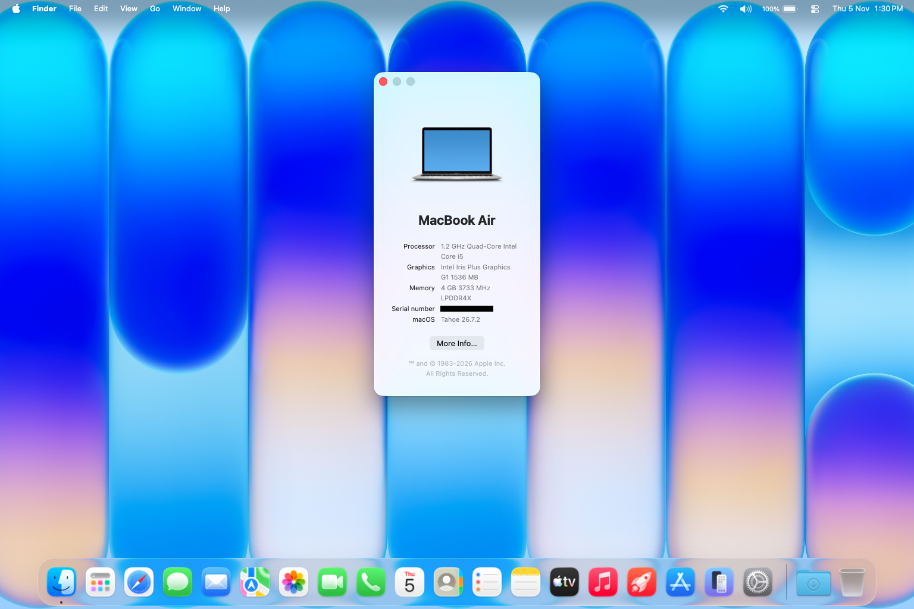

<div align="center">
             
             <h1>macOS on Surface Laptop Go 1 (4GB/64GB)</h1>
</div>

A project using [Acidanthera's OpenCorePkg](https://github.com/acidanthera/OpenCorePkg)

Main goal of the repo was to showcase macOS Tahoe installed and working on eMMC storage and 4GB of RAM.

[](https://github.com/acidanthera/OpenCorePkg/releases/latest) [](https://www.apple.com/macos/) [](https://github.com/ducks-c/SLG1-macOS/releases/latest)

----------

### Notable features of this EFI:
* Compatible with macOS Tahoe
* Working WiFi + Bluetooth
* Working Touchscreen
* iCloud Services
* Modified kexts to make them compatible

----------

### Issues:
* Sleep does not properly work. The display turns off but the fans stay spinning (might be due to the Surface only supporting S0 sleep and not S3)
* Restarting/Shutting Down will give a kernel panic warning on boot (can be dismissed, but functions normally otherwise)

----------

### Future Goals:
* Fix sleep issues with [experimental S0 sleep support for macOS](https://github.com/labrouss/S0ixStandby)
* Fix kernel panic warning on boot
* Tweak config for better CPU performance, fan noise and battery

----------

### Hardware Info:

|**Component**|**Model**|
|:-|:-|
|**CPU**|Intel Core i5-1035G1|
|**GPU**|Intel UHD Graphics (Ice Lake G1)|
|**RAM**|4GB LPDDR4x 3733 MHz|
|**Storage**|64GB eMMC SanDisk DA4064|
|**WiFi/Bluetooth**|Intel Wi-Fi 6 AX201 (201NGW)|
|**Touchpad**|Built-in Precision Trackpad|
|**Display**|12.4" PixelSense Display (1536 x 1024, 10-point touchscreen)|
|**Camera**|720p HD|
|**Battery**|39.7Wh|

----------

### Kexts:
| Kext | Version |
| :--- | :--- |
| Lilu | 1.7.2 |
| VirtualSMC | 1.3.8 |
| SMCProcessor | 1.3.0 |
| CPUFriend | 1.2.5 |
| CPUFriendDataProvider | 1.0.1 |
| WhateverGreen | 1.7.1 |
| RestrictEvents | 1.1.6 |
| EmeraldSDHC (modified) | 0.2.0 |
| BigSurface | 1.1.0 |
| BigSurfaceHIDDriver (modified) | 1.0.0 |
| VoodooGPIO | 1.2.0 |
| VoodooSerial | 1.2 |
| VoodooInput | 1.1.3 |
| USBToolBox | 1.2.0 |
| UTBMap | 1.1 |
| AirportItlwm | 2.4.0 |
| BlueToolFixup | 2.7.3 |
| IntelBluetoothFirmware | 2.5.3 |
| IntelBTPatcher | 2.5.3 |
| VoodooHDA (modified) | 3.6.8 |

----------

## Get Started!

> [!Important]
>
> If you haven't already, I recommend going through the [Opencore install guide](https://dortania.github.io/OpenCore-Install-Guide/) once to fully understand everything that is going on here and to help with troubleshooting incase of any problems

### Prerequisites:
* Any plist editor (Highly recommend [Propertree](https://github.com/corpnewt/ProperTree))
* [GenSMBIOS](https://github.com/corpnewt/GenSMBIOS) to generate SMBIOS information (Use `MacBookAir9,1` **only** as the USB map will not work with other SMBIOSes)
* [OpenCorePkg](https://github.com/acidanthera/OpenCorePkg) for access to it's utilities, specifically `macrecovery` to download an online macOS installer if needed
* [MountEFI](https://github.com/corpnewt/MountEFI)
* The exact spec of the Surface Laptop Go 1 (4GB RAM/64GB eMMC) (Different configs may use this as a base for their own EFI)

### Instructions:
* Download the [latest](https://github.com/ducks-c/SLG1-macOS/releases/latest) version of the EFI
* Extract it and place the EFI folder in the root of your USB drive
* Open `config.plist` using a plist editor
* Generate SMBIOS information using [GenSMBIOS](https://github.com/corpnewt/GenSMBIOS) and paste it into the config.plist
* **Optional:**
  * Edit `boot-args` to your liking.
    * Add `-v`, `debug=0x100` and `keepsyms=1` to help with debugging incase of any issues
  * Tweak your `config.plist` to your liking. Most users will not need to do this
* Save your `config.plist`
* Navigate to the Opencore folder and go to `Utilities/macrecovery`
* Open a terminal in this folder and download the latest release of Tahoe. (Refer [here](https://dortania.github.io/OpenCore-Install-Guide/installer-guide/) on how to do so)
* Place the `com.apple.recovery.boot` folder in the root of your USB after downloading
* **Optional:**
  * Place `MountEFI` and `Propertree` in a separate folder on the USB. This will help save time later on
* Reboot to the BIOS and follow below

### BIOS Configuration
Boot into the BIOS by holding `F4` or `Volume Up` and press the power button.
* Set Secure Boot to None
* Change boot configuration to boot from USB Storage first

> [!CAUTION]
>
> Test drive your configuration once using a USB flash drive before you move it to the main EFI partition. I am not responsible for a broken OS/loss of data, etc...

### Post Installation
Congratulations you've successfully booted your hackintosh! Here's some things to do before moving forward:

* **Fixing Audio**
  * Open the VoodooHDA folder in the EFI in the terminal
  * Run `sudo bash install_voodoohda.sh` and enter your password
  * Open Settings and allow the extension to load from Privacy and Security > Scroll Down > Allow
  * Restart your Surface
  * Note: You can run the script multiple times incase it does not work the first time

* **Booting without USB:**
  * Open [MountEFI](https://github.com/corpnewt/MountEFI)
  * Mount the macOS EFI partition
  * Copy your EFI folder from the USB to the EFI partition now available
  * Reboot your machine without the USB plugged in

* **Additional:**
  * Open System Settings and navigate to Battery
  * Scroll down to `Options...` and do the following:
    * Enable Power Nap: `Never`
    * Put hard disks to sleep when possible: `Never`
    * Wake for network access: `Off`
  * Run the follwing, one line at a time:
    
      ```
      sudo pmset autopoweroff 0
      sudo pmset powernap 0
      sudo pmset standby 0
      sudo pmset proximitywake 0
      sudo pmset tcpkeepalive 0
      ```
      
* **Beauty Treatment (Optional):**
  * In `config.plist`
      * Remove `-v` from `boot-args` to turn off Verbose Mode
      * Turn off the picker. Set `ShowPicker` to `False`
      * Change the scan policy to `769` to hide all NTFS drives from Opencore
      * Turn on Auto login
      
----------

### Screenshots:

<div align="center">
             
             <h5>Tahoe 26.7.2 running on SLG1</h5>
</div>

----------

### What Works:
* Keyboard
* Trackpad and Touchscreen
* Battery indicator
* USB ports
* USB-C Audio Out + Display
* Audio (Speakers, Headphone Jack and Bluetooth)
* Bluetooth
* Ethernet (when connected to dock)
* iCloud Services
* GPU Acceleration
* Camera
* Microphone
* Trackpad with gestures
* CPU Power Management
* AirPlay
* DRM Content

### What isn't working:
* AirDrop, iMessage, Universal Control, Wireless Sidecar (Wifi kext Limitation)
* Ambient Light Sensor (Proprietary ALS implementation)
* Sleep does not properly work. The display turns off but the fans stay spinning (might be due to the Surface only supporting S0 sleep and not S3)
* Restarting/Shutting Down will give a kernel panic warning on boot (can be dismissed, but functions normally otherwise)

### Not Tested:
* Safari DRM
* 3.5mm Headphone Jack (don't own 3.5mm headphones)
* iMessage (don't use it)
* Other macOS versions
* Several small things

----------

### Credits:
* [OpenCore Install Guide](https://dortania.github.io/OpenCore-Install-Guide/)
* [OpenCore Post Install Guide](https://dortania.github.io/OpenCore-Post-Install/)
* [Xiashangning - BigSurface](https://github.com/Xiashangning/BigSurface)
* [olm3ca - Surface-Laptop-Go](https://github.com/olm3ca/Surface-Laptop-Go)
* [5T33Z0 - Alternative Repositories](https://github.com/5T33Z0/OCLP4Hackintosh/blob/main/docs/Forks.md)
* [insanelymac - VoodooHDA Fix](https://www.insanelymac.com/forum/topic/314406-voodoohda-3x/page/19/#comment-2756841)
* Gemini 3.8 Flash High + Google Antigravity (Testing to see how AI does at making/troubleshooting EFIs after my fair share of manual creations for some of my ThinkPads)
